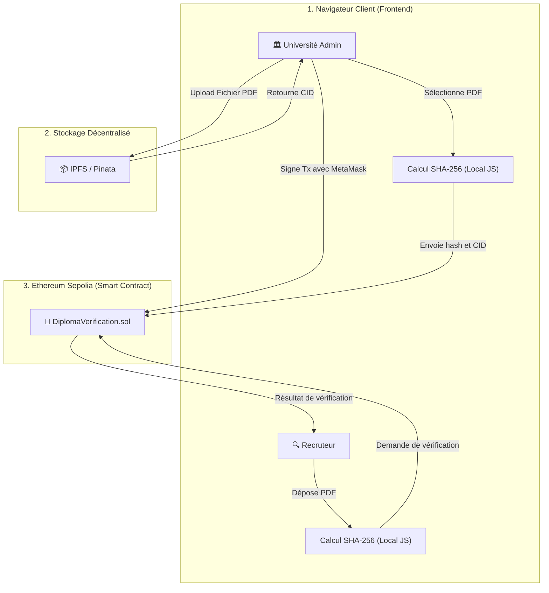

# 🎓 CertifChain - Système de Certification & Vérification de Diplômes sur Blockchain

Projet d'application décentralisée (dApp) permettant l'émission, la certification et la vérification infalsifiable de diplômes académiques en utilisant la blockchain Ethereum et le stockage décentralisé IPFS.

---

## 📌 Présentation du Projet
Les diplômes académiques traditionnels (papier ou PDF simple) sont vulnérables à la falsification numérique. **CertifChain** résout ce problème :
1. **L'Université** enregistre l'empreinte cryptographique (hash SHA-256) du diplôme et son identifiant IPFS (CID) dans un Smart Contract immuable.

2. **Le Recruteur** dépose le fichier PDF reçu sur la plateforme web. Le hash est recalculé localement par le navigateur et vérifié sur la blockchain en **0 seconde, sans frais de gaz**.

3. **Révocation des diplômes :** L'administrateur autorisé peut invalider un diplôme précédemment émis en cas de fraude ou d'erreur.

---


## 🏗️ Architecture du Projet




## 🛠️ Technologies Utilisées

**Smart Contract** : Solidity (^0.8.34)

**Blockchain** : Ethereum Testnet Sepolia

**Environnement de Dev** : Remix IDE

**Front-End** : HTML5, Tailwind CSS, JavaScript ES6

**Interaction Web3** : ethers.js (v6)

**Stockage Décentralisé** : IPFS via Pinata API

**Portefeuille Web3** : Extension MetaMask


## 📋 Informations du Smart Contract


**Adresse du contrat déployé (Sepolia)** : 0x21F35365a6547Db760910D4d788f2Dd511a7753A

**Fonctions principales** :

issueDiploma(bytes32 _pdfHash, string _studentName, string _major, string _ipfsCID) : Réservé à l'université (onlyAdmin). Enregistre le diplôme.

verifyDiploma(bytes32 _pdfHash) : view returns (...) : Fonction de lecture publique gratuite (0 gas).

revokeDiploma(bytes32 _pdfHash) : Permet à l'université d'invalider un diplôme en cas d'erreur ou de fraude.


## 🧪 Tests du Smart Contract

Les tests unitaires automatisés ont été exécutés avec succès dans Remix IDE.

1. Vérification de l'attribution correcte de l'adresse administrateur (universityAdmin).

2. Enregistrement conforme et persistance des métadonnées d'un diplôme.

3. Vérification avec succès d'un diplôme authentique (exists = true, isValid = true).

4. Détection et rejet immédiat d'un diplôme falsifié ou altéré (exists = false).

5. Blocage strict lors d'une tentative d'enregistrement d'un diplôme en double.

6. Révocation effective d'un diplôme et validation de son statut révoqué (isValid = false).


## 🚀 Installation & Exécution Locale


1. Cloner ou télécharger le dossier du projet.
2. Lancer un serveur web local dans le dossier :

   ```bash
   python -m http.server 3000
   ```

4. Ouvrir votre navigateur sur :

   http://localhost:3000

5. Connecter MetaMask configuré sur le réseau **Sepolia**.


